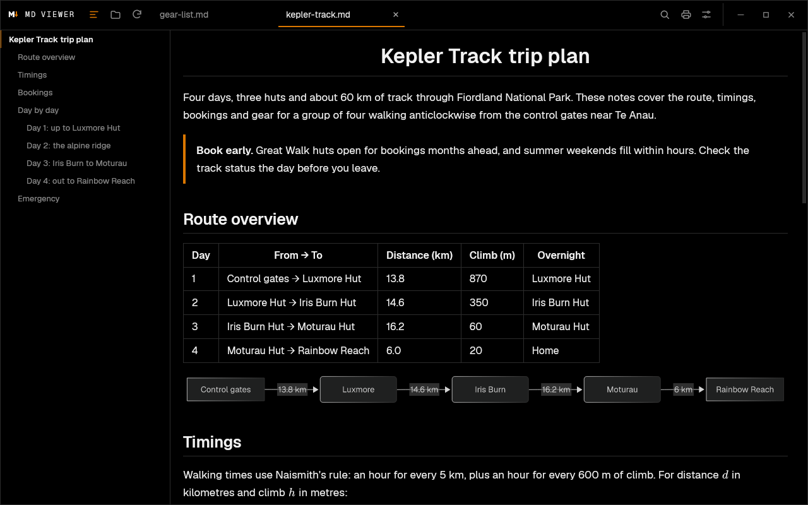
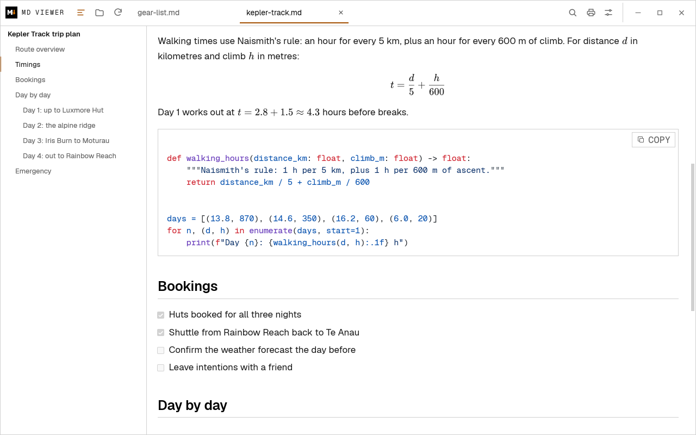
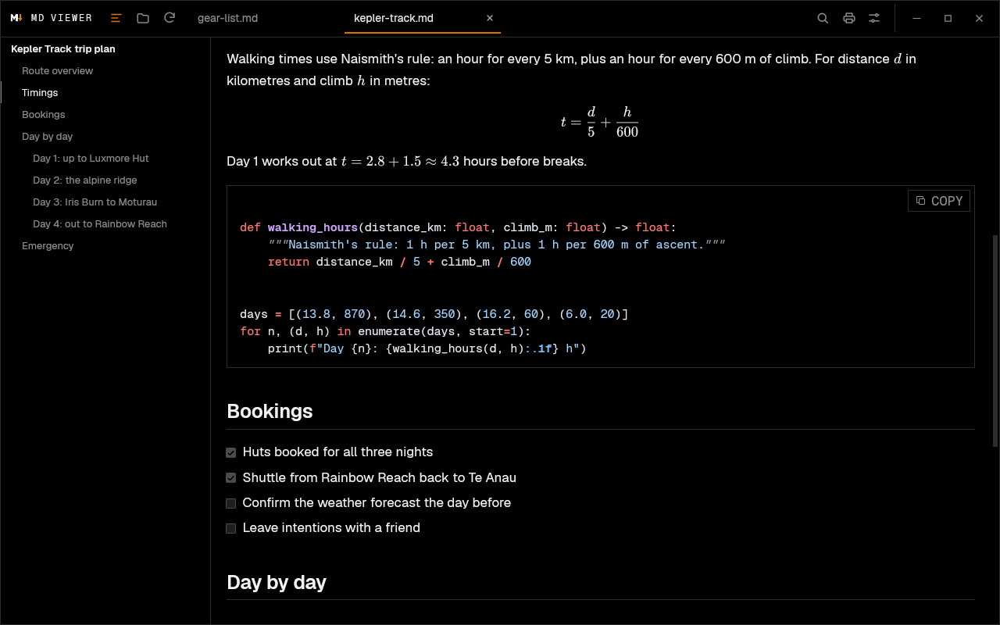
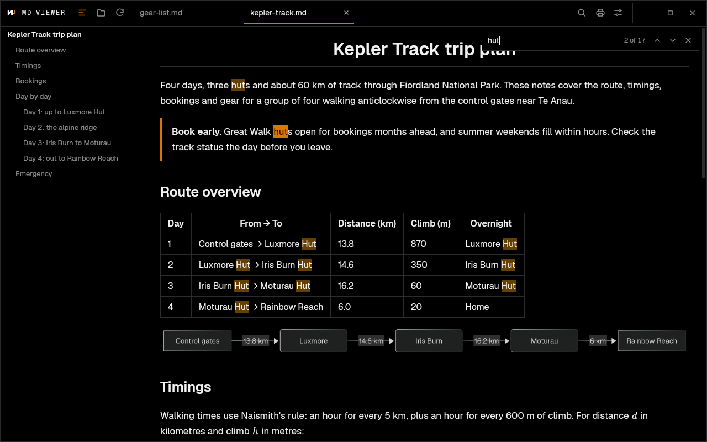
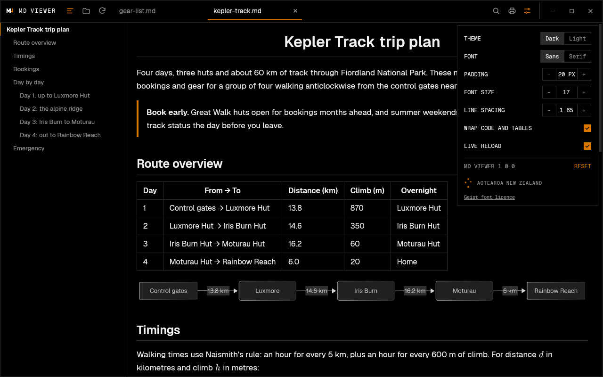

# MD Viewer

A small, fast markdown viewer for Windows, macOS and Linux. It's a single
executable with no installer and no runtime to set up, written in Rust with
[GPUI](https://www.gpui.rs).

<p align="center">
  <a href="docs/screenshots/dark.png"></a>
</p>
<p align="center">
  <a href="docs/screenshots/light.png"></a>
  <a href="docs/screenshots/diagrams.png"></a>
  <a href="docs/screenshots/find.png"></a>
  <a href="docs/screenshots/settings.png"></a>
</p>
<p align="center"><sub>Click a screenshot to see it full size.</sub></p>

- Tabs: open several files at once, reorder them or move them between windows;
  opening a file again switches to its existing tab
- Dark mode by default, with a light theme
- GitHub-flavoured markdown: tables, task lists, footnotes, strikethrough,
  autolinks and definition lists
- Syntax highlighting for fenced code blocks, with a copy button
- Sortable tables: click a column heading to sort it
- Save as PDF, always in light colours
- Mermaid diagrams and maths, drawn in the app (no internet needed)
- Table of contents sidebar
- Find in document, including parts of large files not yet on screen
- Adjustable font size, line spacing and font
- Word wrap for code blocks and tables, which can be turned off
- Handles large files (tested to 25 MB) by laying out only what's near the
  screen
- Opens local `.md` links in a new tab; web links open in your browser
- Bundled Geist fonts; nothing is downloaded at run time

## Download

Get the latest build from the [Releases](../../releases) page, and check it
against `SHA256SUMS.txt`.

| Platform | File | Notes |
|---|---|---|
| Windows 10/11 (x86-64) | `md-viewer-*-windows-amd64.exe` | Needs a Direct3D 11 graphics driver, which any current PC has. The file isn't code-signed, so SmartScreen may ask the first time: choose **More info**, then **Run anyway**. |
| macOS 11+ (Apple silicon and Intel) | `md-viewer-*-macos-universal.zip` | See the macOS note below. |
| Linux (x86-64) | `md-viewer-*-linux-amd64.tar.gz` | Needs a Vulkan driver (for example `mesa-vulkan-drivers`) and X11 or Wayland. |

**macOS is untested.** The macOS build comes from the same code and compiles, but
nobody has run it on a Mac yet, so expect rough edges and please report them.
The app isn't notarised, so the first time, unzip it, move `MD Viewer.app` to
Applications, right-click it and choose **Open**, or run
`xattr -cr "/Applications/MD Viewer.app"`.

Every release file carries a build attestation, so you can check it was built
from this repository: `gh attestation verify <file> --repo <owner>/<repo>`.

## Usage

Open files with **Open** (Ctrl+O) or from the command line. Each file gets its
own tab:

```
md-viewer notes.md README.md
```

Drag a tab along the strip to reorder it, outside the viewer to open a new
window, or onto another window's tab strip to move it there. Press Escape to
cancel. Reading position follows
the tab; its source window closes if it has no tabs left. On Wayland, an
outside drop cancels the move.

Files stay open in one tab across all windows. New files from another launch
open in the most recently focused window. Tabs aren't restored on startup.

To make it the default app for `.md` files on Windows, right-click a markdown
file, choose **Open with › Choose another app**, browse to the executable and
tick **Always use this app**. On macOS, use **Get Info › Open with**.

### Saving as PDF

Press Ctrl+P. MD Viewer asks where to save, renders the whole document as a
PDF in light colours whatever theme you're using, and offers to open it. Very
large files can take a while to prepare, and you can cancel this.

### Keyboard shortcuts

On macOS, use ⌘ in place of Ctrl (except for Ctrl+Tab, which is the same on
every platform).

| Action | Shortcut |
|---|---|
| Open file (new tab) | Ctrl+O |
| Close tab | Ctrl+W |
| Next / previous tab | Ctrl+Tab / Ctrl+Shift+Tab (or Ctrl+PgDn / Ctrl+PgUp) |
| Go to tab 1–8 / last tab | Ctrl+1 … Ctrl+8 / Ctrl+9 |
| Save as PDF | Ctrl+P |
| Table of contents | Ctrl+B |
| Find | Ctrl+F, then Enter / Shift+Enter (or F3 / Shift+F3) |
| Larger / smaller text | Ctrl+= / Ctrl+- |
| Reset text size | Ctrl+0 |
| Toggle dark / light | Ctrl+Shift+D |
| Copy / select all | Ctrl+C / Ctrl+A |

## Building from source

You need [Rust](https://rustup.rs); the repository pins the version in
`rust-toolchain.toml`. On Linux, install the packages listed in
[docs/BUILDING.md](docs/BUILDING.md). Then:

```
cargo build --release
```

The executable is `target/release/md-viewer` (`md-viewer.exe` on Windows).
Run the tests with `cargo test --workspace`.
[docs/BUILDING.md](docs/BUILDING.md) covers the platform details, how releases
are made (including precompiled Windows shaders and the macOS bundle), the
dependency checks and the screenshots.

### How it works

Markdown is parsed with [pulldown-cmark](https://github.com/pulldown-cmark/pulldown-cmark)
into a document model, which the app lays out and draws itself with GPUI: there
is no web view. Only blocks near the window are laid out and painted, and
files over 1 MB are parsed in parallel sections, so a 25 MB file opens quickly. Maths (RaTeX) and Mermaid
diagrams are turned into vector images in the app. [SECURITY.md](SECURITY.md)
describes what a document can and can't do, and how to report a problem.

## Licence

MIT. See [LICENSE](LICENSE). Bundled fonts and the Rust crates in the
executable are listed in [THIRD-PARTY.md](THIRD-PARTY.md).
